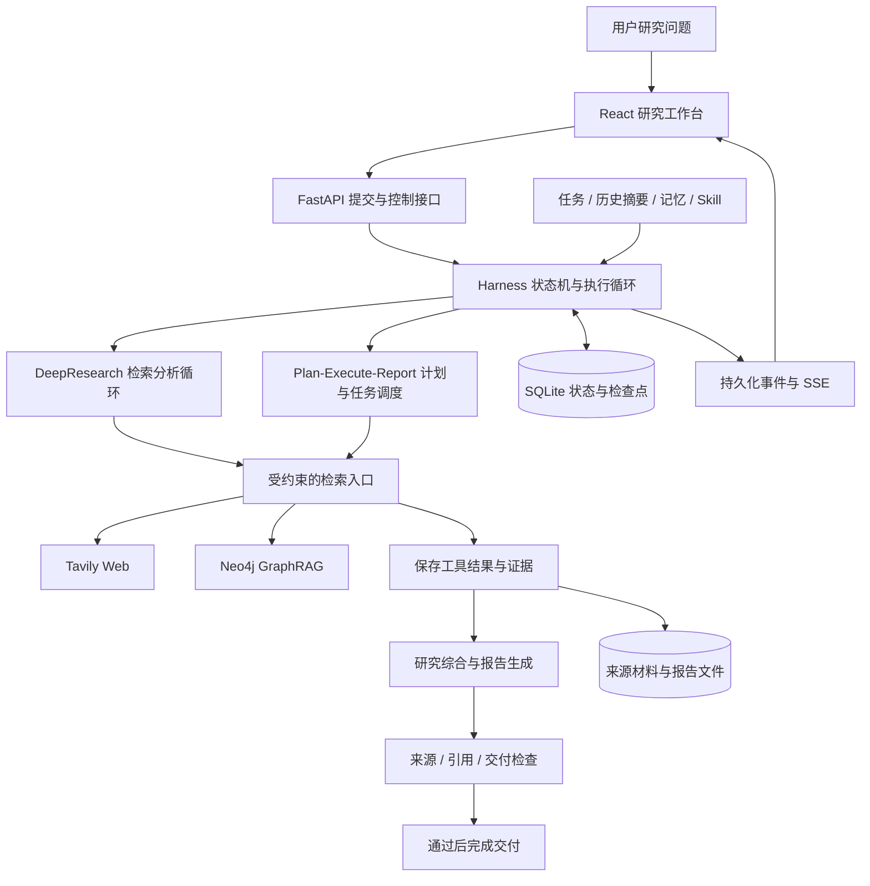

# DeepTrace

**面向深度研究的可恢复、可追溯 Agent Harness**

DeepTrace 围绕用户提出的研究目标，进行资料检索、缺口分析和证据整合，生成带来源引用的研究报告；支持连续追问、研究进度查看，以及中断后继续执行。

项目重点是两件事：**研究如何持续推进，执行进度如何可靠保存和复用。** 模型负责提出研究计划、分析材料和下一步查询，外层 Harness 用程序管理阶段流转、工具调用、资源预算、进度保存和最终交付。

[核心能力](#核心能力) · [架构与执行流程](#架构与执行流程) · [恢复与追溯验证](#恢复与追溯验证) · [快速启动](#快速启动) · [测试与评测](#测试与评测)

## 核心能力

### 两种研究工作流

| 工作流 | 如何推进 | 适用场景 |
|---|---|---|
| **DeepResearch** | 检索资料 → 提取带证据的发现 → 区分事实缺口与综合分析需求 → 在限制内继续补查或进入报告 | 研究路径尚不明确，需要边查边调整的问题 |
| **Plan-Execute-Report** | 生成结构化任务及依赖 → 执行任务并复用前置证据 → 汇总报告 → 验证交付 | 可以拆解为多个方面、需要明确覆盖范围的问题 |

计划执行模式中的深入研究子任务也可以运行有界检索循环；两种模式共用 Harness 的执行管理。当前 Web 主链路主要使用结构化决策和程序调度，不以模型原生 Tool Calling 作为统一执行协议。

### Harness 可靠运行时

- **阶段控制**：显式状态转换规则与 Python 执行循环，推进上下文构建、规划、研究、报告和验证。
- **进度保存**：将执行快照、任务、工具结果和证据持久化至 SQLite，保留模型调用之外的执行事实。
- **阶段与步骤恢复**：按原运行编号读取检查点；报告已保存时接着验证，研究步骤中断时结合内部进度继续。
- **结果复用**：同一工具调用已有完成记录时读取保存结果，避免恢复时重复执行已持久化的检索。
- **执行约束**：运行租约、暂停与取消、单次检索超时，以及工具次数、Token、重试、重规划和总时间预算。
- **交付门槛**：必需检查通过后才更新完成状态并写入最终回答；报告生成成功与研究交付完成分开处理。

已保存结果的复用不等于所有外部操作恰好执行一次。外部请求成功、结果尚未落库时退出，恢复后仍可能重复请求。

### 过程可观测与证据追溯

按 **运行 → 任务 → 工具调用 → 证据 → 报告引用** 关联执行记录：

- 展示当前阶段、子任务、检索工具与查询、用量和错误详情。
- 通过持久化事件与 SSE 更新进度，前端断线后按事件编号补取。
- 查看上下文组成、摘要压缩、历史召回和裁剪记录。
- 检查引用是否对应本次研究的有效证据，并回查任务、调用及保存材料。
- 展示逐项交付检查和报告审查依据，便于区分材料缺失、任务传递与写作问题。

**引用可追溯与引用支持结论是两层检查。** 编号、归属和材料哈希正确，不代表来源一定支持报告中的每个判断。

### Web 与 GraphRAG 检索

每次运行固定资料来源，检索失败不自动切换到另一来源；历史问答和 Memory 用于理解任务，不自动成为本次研究证据。

| 来源 | 当前实现 |
|---|---|
| **Web** | Tavily 获取网页材料，规范化网址、去重并转换成统一证据；保留调用结果和可用的来源快照 |
| **GraphRAG** | 读取私有文档、递归字符切块、模型抽取实体关系并写入 Neo4j，生成实体及文本块向量，整理实体并划分社区、生成社区摘要 |

私有库提供普通、局部、全局、混合四种工具实现。普通检索查相似文本块；局部检索围绕实体取得关系和关联材料；全局检索按关键词匹配指定层级的社区材料，再分批分析汇总；混合检索结合实体细节与社区主题。

### 上下文、记忆与 Skill

- **上下文分块**：组织当前任务、近期消息、会话摘要、记忆快照及相关技能。
- **增量摘要**：达到门槛后将较早消息合并进旧摘要，记录覆盖位置，优先保留近期原文、目标、约束和未解决事项。
- **按需召回**：在明确需要历史会话时进行全文检索，存在歧义则请求澄清。
- **预算裁剪**：按块估算 Token，用保护规则和优先级控制上下文包大小，原始消息仍保留在数据库。
- **记忆治理**：区分用户信息、项目事实、候选和已启用记忆；会话首次需要时冻结精选记忆快照。
- **运行复盘**：从轨迹提炼候选 Skill，经过审查、加载/不加载的配对评测与人工批准后启用；技能按来源与触发条件加载。

## 架构与执行流程



正常阶段为：

```text
排队 → 构建上下文 → 规划 → 执行研究 → 生成报告 → 验证 → 完成
```

程序根据执行结果决定后续动作：材料不足时按工作流规则补查或重新规划，报告问题可有限修复；预算耗尽、取消和无法恢复的失败单独记录。不是所有错误都会自动重试，也不是验证失败就无限循环。

### 状态、内容与持久化的职责

| 模块 | 负责什么 | 关键入口 |
|---|---|---|
| 执行控制 | 阶段推进、预算、暂停取消、恢复 | [运行器](src/deepresearch_agent/harness/runtime.py)、[状态机](src/deepresearch_agent/harness/state_machine.py) |
| 研究决策 | 任务拆分、分析发现、缺口与下一条查询 | [研究循环](src/deepresearch_agent/retrieval/research_loop.py)、[计划执行模块](src/deepresearch_agent/agents/multi_agent/) |
| 检索与证据 | 来源路由、工具执行、结果保存和证据编号 | [检索模块](src/deepresearch_agent/retrieval/)、[调用持久化](src/deepresearch_agent/harness/retrieval_runtime.py) |
| 上下文 | 分块、增量摘要、历史召回与裁剪 | [上下文模块](src/deepresearch_agent/context/) |
| 数据与事件 | 运行记录、工具结果、检查点、审计和推送 | [持久化层](src/deepresearch_agent/persistence/)、[事件服务](backend/app/services/event_stream.py) |

**运行状态由程序更新。** 模型可以提出计划和内容判断，但不能通过输出“已完成”绕过实际执行、保存与交付检查。

## 恢复与追溯验证

以下是 **2026-10-30 保存的专项实验结果**，属于有明确范围的工程验证，不是通用研究质量分数。

| 验证项 | 已有结果 | 统计范围 |
|---|---:|---|
| 中断恢复实验 | **60 / 60 全部通过** | 5 类中断位置 × 4 类执行负载 × 每组合重复 3 次 |
| 已保存搜索复用 | **90 个应复用操作，0 个重复执行** | 按独立落盘的实际调用日志检查 |
| 最终回答唯一性 | **60 / 60** | 每次实验最终恰好一条回答 |
| 真实运行引用追溯 | **396 / 396 处通过** | 8 份正式回答、3 份失败草稿，共 107 个不同证据编号 |

引用审计共选取 12 次真实运行，其中 1 次没有报告，未记为满分。离线恢复实验另有 150 处合成引用，未混入上述 396 处真实运行引用。

### 故障位置与负载

| 中断位置 | 恢复预期 |
|---|---|
| 计划已保存 | 开始执行，不重新规划 |
| 首轮搜索已保存、尚未分析 | 复用搜索结果，从分析继续 |
| 首个完整任务已保存 | 继续后续任务，或在没有后续任务时生成报告 |
| 报告已保存 | 进入验证，不重新生成报告 |
| 验证检查点已保存、尚未交付 | 可按规则重做检查，最终只交付一次 |

四种负载为单任务单次检索、单任务三轮检索、三个独立任务顺序执行，以及后续任务继承两个前置任务证据的依赖负载。

实验在检查点提交后硬退出进程，再通过新进程的启动扫描恢复同一运行。**模型和搜索使用确定性替身，状态机、SQLite、工具结果缓存及恢复调度使用实际实现。** 断言覆盖恢复阶段、首动作、进度与证据保留、操作次数、检查点完整性和回答唯一性。

这些结果不证明真实模型研究质量，也不覆盖外部成功但未落库、磁盘损坏、多执行者竞争或跨代码版本迁移；依赖负载按确定顺序执行，不代表生产并发任务调度已被完整验证。

复现入口：[专项脚本](scripts/evaluate_harness_acceptance.py)、[追溯审计](src/deepresearch_agent/evaluation/provenance.py)、[验收规则测试](tests/evaluation/test_harness_acceptance.py)。本地原始结果位于 `output/evaluation/harness-matrix-60-20261030-v1/`；`output/` 默认不随源码提交。

## 快速启动

### 环境与配置

推荐 Python 3.11、Node.js 20；Docker 为可选部署方式。Web 研究需要生成模型和 Tavily 配置；私有库还需要 Neo4j、APOC、GDS、Embedding 模型和预先构建的资料。

在项目根目录创建本地配置文件，已有 `.env` 时保留。环境文件不随仓库提交：

```powershell
if (-not (Test-Path -LiteralPath '.env')) {
    New-Item -ItemType File -Path '.env' | Out-Null
}
```

将下面的最小配置填写到本地 `.env`，模型地址和名称按实际服务修改，密钥不要提交：

```dotenv
OPENAI_API_KEY=
OPENAI_BASE_URL=https://your-model-service.example/v1
OPENAI_LLM_MODEL=your-model-name
TAVILY_API_KEY=
FASTAPI_WORKERS=1
AUTO_RESUME_RUNS=true
NEO4J_PASSWORD=
```

按实际服务填写：

| 配置 | 用途 |
|---|---|
| `OPENAI_API_KEY` / `OPENAI_BASE_URL` / `OPENAI_LLM_MODEL` | OpenAI 兼容的生成模型服务；示例文件中的地址需按实际服务修改 |
| `TAVILY_API_KEY` | Web 检索 |
| `OPENAI_EMBEDDINGS_MODEL` / `OPENAI_EMBEDDING_DIMENSIONS` | 私有库向量生成；维度需与已建索引对应 |
| `EMBEDDING_API_KEY` / `EMBEDDING_BASE_URL` | 可选的独立 Embedding 服务 |
| `NEO4J_URI` / `NEO4J_USERNAME` / `NEO4J_PASSWORD` | 私有图谱连接；使用完整 Docker Compose 时也需设置 Neo4j 密码 |
| `APP_DATABASE_URL` / `ARTIFACT_ROOT` | SQLite 与来源、报告文件目录 |
| `FASTAPI_WORKERS=1` | 当前本地运行模式要求单个 API 工作进程 |

完整配置项及默认值见 [settings.py](src/deepresearch_agent/config/settings.py)。

### 本地开发

可以激活已有 Python 环境，或新建虚拟环境后安装依赖：

```powershell
python -m venv .venv
.\.venv\Scripts\Activate.ps1
python -m pip install -r requirements.txt
```

在项目根目录启动后端：

```powershell
$env:PYTHONPATH = Join-Path (Get-Location).Path 'src'
python -m alembic upgrade head
python -m uvicorn backend.app.main:app --host 127.0.0.1 --port 8000 --workers 1
```

另开终端启动前端：

```powershell
cd frontend
npm ci
npm run dev
```

访问 [研究工作台](http://127.0.0.1:5173/) 和 [API 文档](http://127.0.0.1:8000/docs)。仅测试 Web 研究时可先不启动 Neo4j，并在界面选择“联网搜索”。

依赖安装完成后，也可以使用 [本地启动脚本](scripts/start-local.ps1)：

```powershell
# 仅启动应用，不自动启动 Neo4j
.\scripts\start-local.ps1 -SkipNeo4j

# 停止该项目的本地服务
.\scripts\stop-local.ps1
```

### 私有库准备

1. 配置 Neo4j 连接和 Embedding 服务，准备 APOC 与 GDS。
2. 将资料放入 `files/`，按资料领域核对实体与关系类型配置。
3. 明确需要全量建库时，再执行下方命令。

**全量构建会清理旧索引和图数据，并调用模型及 Embedding 服务。已有私有库不要直接重跑。**

```powershell
python build_knowledge_graph.py
```

当前默认实体类型围绕临床药物治疗资料配置，换用其他领域资料时需要调整相应配置。应用启动本身不代表私有库已建好。

### Docker Compose

[Compose 配置](docker-compose.yaml) 包含 Neo4j、后端和前端，后端会等待 Neo4j 健康检查通过。配置好模型服务、Tavily 及 Neo4j 密码后执行：

```powershell
docker compose up -d --build
```

默认访问端口为前端 `5173`、API `8000`、Neo4j Browser `7474`。`OPENAI_BASE_URL` 如果填写本机地址，需要按容器网络配置；容器中的 `localhost` 指向容器自身。Compose 不会自动导入私有文档。

## 如何体验

1. 新建会话，选择联网或私有库来源，再选择一种工作流。
2. 输入一个范围明确的问题，例如：“比较近期消息窗口与会话摘要的适用场景、优缺点，并引用来源。”
3. 查看阶段轨迹，展开任务、搜索调用、上下文和验证详情。
4. 报告生成后，从正文引用回查证据与来源；连续追问时观察历史与摘要如何进入上下文。
5. 体验恢复时，可以先暂停再恢复；验证进程异常退出则应另做中断实验，不能将暂停成功当作崩溃恢复已验证。

问题复杂度、模型服务和检索结果会影响耗时、成本及交付结果。失败或预算耗尽时保留相应状态和可用记录，不用非空报告代替完成判断。

## 测试与评测

### 程序与集成测试

以下命令在已安装依赖的项目根目录运行，默认不调用真实模型或 Tavily：

```powershell
python -m pytest tests/harness tests/evaluation tests/retrieval tests/api -q
```

前端测试、类型检查与构建：

```powershell
cd frontend
npm test
npm run build
```

### 离线恢复专项

以下会在新的输出目录创建隔离测试库，执行默认 60 次实验，不连接真实搜索或模型服务；目录已存在时拒绝覆盖。

```powershell
python scripts/evaluate_harness_acceptance.py --output output/evaluation/harness-local-01 --repetitions 3
```

同时审计已有研究运行时，按实际试次目录增加 `--trial-root`。输出包括实验配置、逐场景结果、调用日志及汇总报告。

### 已有运行与报告质量评审

读取应用已保存的运行记录并导出统计：

```powershell
python scripts/evaluate_runs.py --output output/evaluation/summary.json
```

这个命令不会重新研究；没有独立质量标签时，运行完成和引用 ID 有效性不等于事实准确率。

报告质量另用冻结评审包：保存题目要求、实际报告、可核验来源和用量，再标注需求覆盖、主张支持及分析、遵循要求、可读性；未评项目保留待评，人工和模型评审分开汇总。见[研究质量评审说明](evals/research/README.md)和[系统指标说明](evals/system/README.md)。

真实模型与联网批量运行由 [evaluate_workflows.py](scripts/evaluate_workflows.py) 等脚本提供，需要显式执行并消耗 API 配额。小规模开发集、Skill 配对检查和工程恢复验收，分别报告，不合并为一个“Agent 准确率”。

## 常用接口

| 方法 | 路径 | 用途 |
|---|---|---|
| `POST` | `/api/v1/sessions/{id}/messages` | 提交研究，返回运行编号 |
| `GET` | `/api/v1/runs/{id}` | 状态、阶段、用量和错误 |
| `GET` | `/api/v1/runs/{id}/events` | 持久化事件与 SSE 进度 |
| `GET` | `/api/v1/runs/{id}/context` | 本次上下文组成和处理记录 |
| `GET` | `/api/v1/runs/{id}/evidence` | 本次证据 |
| `GET` | `/api/v1/runs/{id}/report` | 报告、证据展示和检查结果 |
| `POST` | `/api/v1/runs/{id}/pause` | 请求暂停 |
| `POST` | `/api/v1/runs/{id}/resume` | 恢复原运行 |
| `POST` | `/api/v1/runs/{id}/cancel` | 取消任务 |
| `GET` | `/api/v1/sessions/{id}/whiteboard` | 会话与运行轨迹 |

记忆、Skill、复盘和评测接口以运行后的 OpenAPI 文档为准。

## 项目结构与技术栈

```text
backend/                         FastAPI、运行调度、事件与控制接口
frontend/                        React + TypeScript 研究工作台
src/deepresearch_agent/
  harness/                       状态机、预算、检查点、恢复与交付验证
  retrieval/                     研究循环、来源路由与检索接口
  agents/multi_agent/             计划、任务执行、报告与审查
  context/                       上下文组装、增量摘要与预算裁剪
  memory/                        精选记忆与候选提取
  sessions/                      历史会话检索
  evolution/                     候选 Skill、审查、配对评测与批准
  graph/                         实体关系写入、索引与实体整理
  community/                     社区检测与摘要
  pipelines/ingestion/           文档读取与切分
  persistence/                   SQLAlchemy、SQLite、文件与迁移
  evaluation/                    运行统计、追溯审计与报告质量评审
tests/                           程序规则与隔离集成测试
evals/                           题目、评分要求与评测说明
scripts/                         启停、故障实验及研究评测
```

核心技术为 Python、Pydantic、FastAPI、SQLAlchemy、SQLite、Tavily、Neo4j/APOC/GDS；前端使用 React 18、TypeScript、Vite、TanStack Query 和 SSE，部署配置使用 Docker Compose。模型调用与部分图谱链路使用 LangChain，Harness 主循环通过 Python 管理执行阶段。
